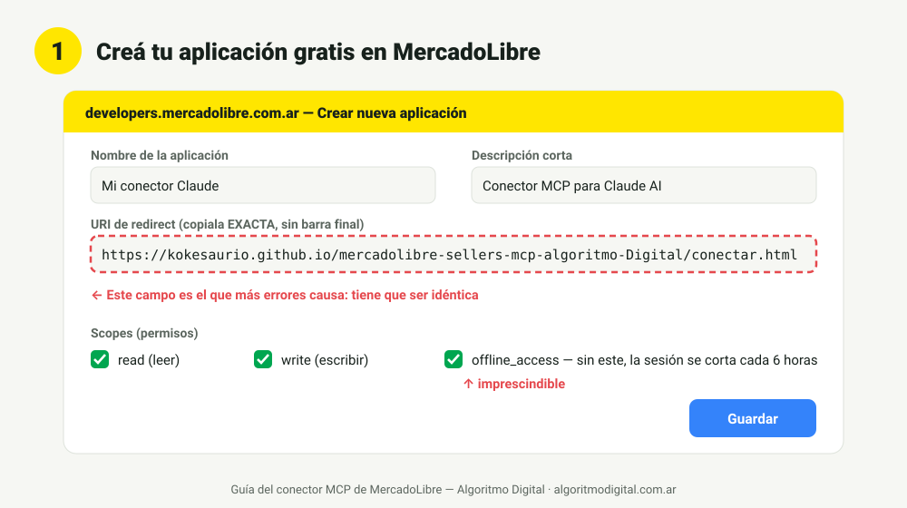
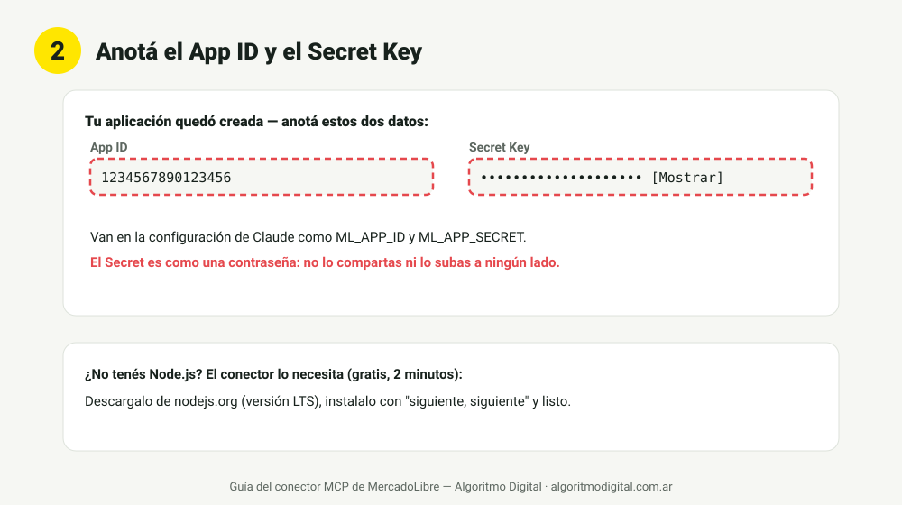
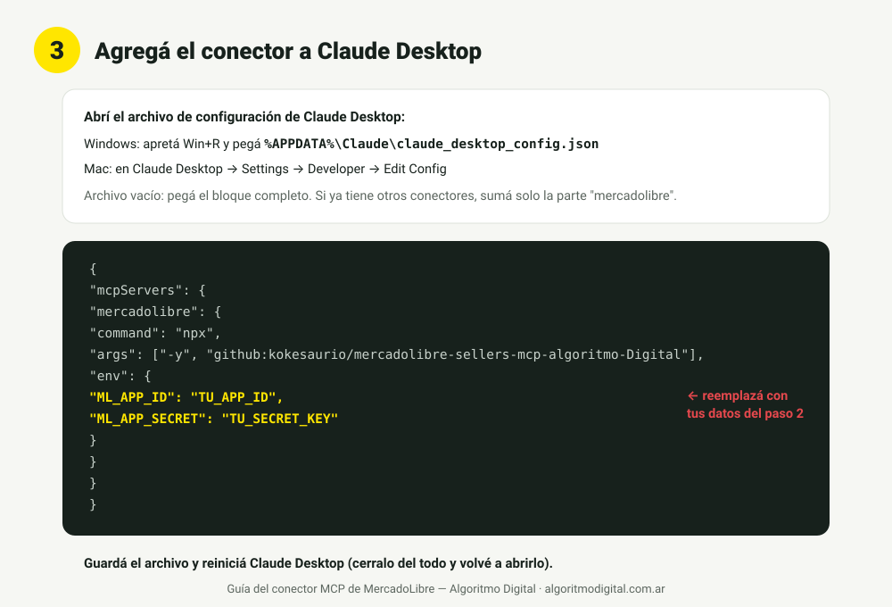
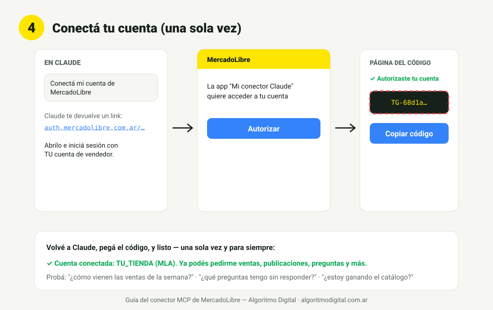
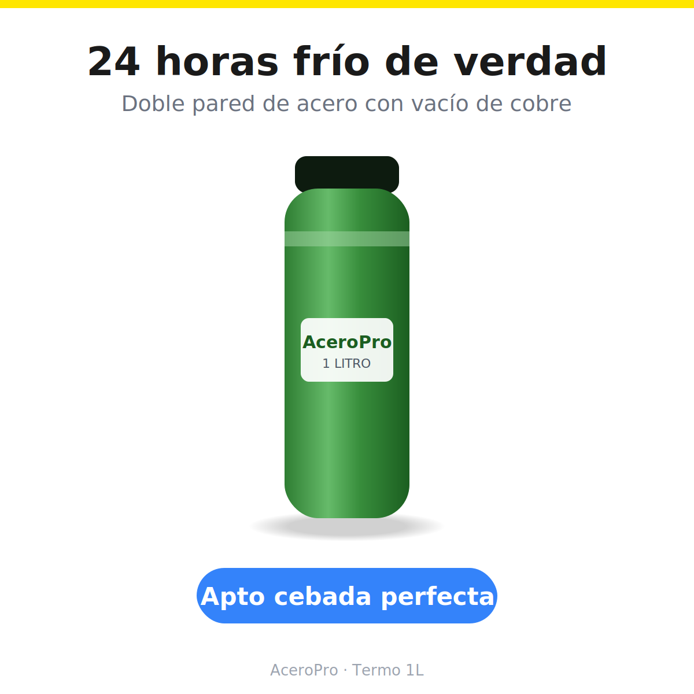
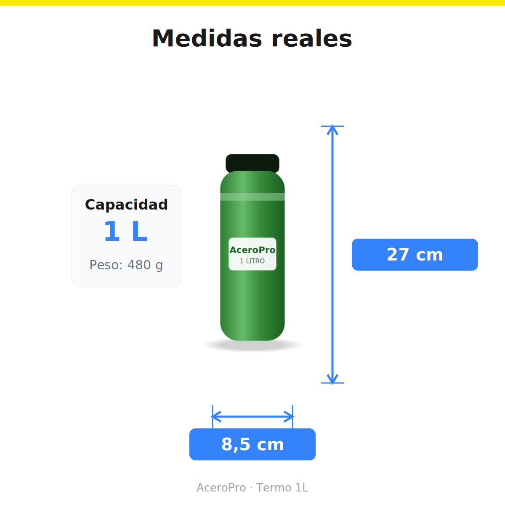

# MCP de MercadoLibre para vendedores — conectá tu tienda a Claude sin servidor

[](https://github.com/kokesaurio/mercadolibre-sellers-mcp-algoritmo-Digital/actions)
[](CHANGELOG.md)
[](LICENSE)
[](https://github.com/kokesaurio/mercadolibre-sellers-mcp-algoritmo-Digital/stargazers)

**Palabras clave:** MCP MercadoLibre · MercadoLibre Claude · conectar MercadoLibre a Claude · API MercadoLibre IA · Model Context Protocol MercadoLibre · vendedores MercadoLibre · automatizar MercadoLibre con IA

Conectá tu cuenta de MercadoLibre a Claude y manejá tu tienda en lenguaje natural:

- *"¿cómo vienen las ventas hoy?"* → tablero con facturación, top productos, envíos y provincias
- *"¿qué preguntas tengo sin responder?"* → te propone todas las respuestas y publica las que apruebes
- *"auditá mis publicaciones"* → semáforo 🔴🟡🟢 con qué arreglar en cada una (fotos, título, video faltante, catálogo)
- *"armame las imágenes de esta publicación"* → el set de 4 infografías profesionales con tus fotos reales
- *"hacé un video para Reels de este producto"* → guion por escenas y video con tus datos verdaderos
- *"¿qué cambió en la competencia?"* → solo las novedades: precios movidos, publicaciones nuevas, ventas estimadas del rival

**30 herramientas · 18 skills · multicuenta con consolidado · sin servidor propio · tokens solo en tu computadora** — hecho por [Algoritmo Digital](https://algoritmodigital.com.ar), consultora especializada en MercadoLibre.

```text
Claude ──MCP──► este conector ──OAuth 2.0 + PKCE──► API oficial de MercadoLibre
```

> ⭐ **¿Te sirve el conector?** [Dejanos una estrella](https://github.com/kokesaurio/mercadolibre-sellers-mcp-algoritmo-Digital/stargazers) — es gratis para vos y hace que más vendedores lo encuentren en GitHub y Google.

## Por qué este y no otro

| | Este conector | Alternativas típicas |
| --- | --- | --- |
| Onboarding | **Guiado desde cero**: decile "setup" a Claude y te deja operativo | Asumen que ya tenés los tokens de ML (conseguirlos es la parte difícil) o exigen una base Supabase |
| Infraestructura | **Ninguna**: tokens en un archivo local (0600), refresh automático serializado | Backend propio, Supabase o VPS |
| Idioma | Castellano, pensado para vendedores | Inglés técnico, pensado para developers |
| Seguridad | PKCE, escrituras opcionales (`ML_SOLO_LECTURA=1` las desactiva), sin telemetría | Varía |
| Pruebas | **Suite E2E de 42 casos** contra un MercadoLibre simulado, corriendo en CI en cada cambio | Rara vez |
| Skills | **18 skills** incluidas, del reporte diario al video del producto | No |

¿Tenés varias tiendas, querés rentabilidad real con tus costos, caja de MercadoPago y vigilancia de competidores gestionada? Eso es nuestro [conector premium con CRM](https://github.com/kokesaurio/mercadolibre-algoritmodigital) — este conector directo es gratis y para cualquier vendedor.

## Guía de instalación (10 minutos, sin servidor, paso a paso)

No hace falta saber programar. Necesitás: una cuenta de vendedor de MercadoLibre, [Claude Desktop](https://claude.ai/download) y [Node.js LTS](https://nodejs.org) instalados (ambos gratis, se instalan con "siguiente, siguiente").

### ⚡ Vía rápida A — Instalador automático (1 solo comando)

Abrí una terminal (**Windows**: `Win + R` → escribí `cmd` → Enter · **Mac**: app Terminal) y pegá:

```bash
npx -y github:kokesaurio/mercadolibre-sellers-mcp-algoritmo-Digital instalar
```

El instalador te guía para crear tu app gratis de MercadoLibre, te pide el App ID y el Secret, y **configura Claude Desktop solo**: respeta los conectores que ya tengas, hace backup de tu configuración anterior y te deja a un reinicio de usarlo. (Si ya tenés las credenciales: agregá `--app-id TU_APP_ID --secret TU_SECRET`.)

### ⚡ Vía rápida B — Que Claude lo instale por vos (Cowork / Claude Code)

¿Usás Claude Cowork o Claude Code? Pegale este prompt tal cual y listo:

```text
Instalame el conector de MercadoLibre de Algoritmo Digital:
1. Si todavía no tengo App ID y Secret, guiame a crearlos gratis en
   https://developers.mercadolibre.com.ar (app nueva, URI de redirect EXACTA
   https://kokesaurio.github.io/mercadolibre-sellers-mcp-algoritmo-Digital/conectar.html
   y scopes read, write y offline_access) y pedímelos.
2. Ejecutá: npx -y github:kokesaurio/mercadolibre-sellers-mcp-algoritmo-Digital instalar --app-id <MI_APP_ID> --secret <MI_SECRET>
3. Verificá que claude_desktop_config.json quedó con el conector "mercadolibre"
   y avisame que reinicie Claude Desktop.
4. Después del reinicio te digo "conectá mi cuenta de MercadoLibre" y me guiás.
Guía: https://github.com/kokesaurio/mercadolibre-sellers-mcp-algoritmo-Digital
```

### Vía manual paso a paso (con imágenes)

¿Preferís hacerlo a mano o entender cada paso? Seguí la guía ilustrada:

### Paso 1 — Creá tu aplicación gratis en MercadoLibre

Entrá a [developers.mercadolibre.com.ar](https://developers.mercadolibre.com.ar) con tu cuenta de vendedor → **Mis aplicaciones** → **Crear nueva aplicación** y completá así:



- **URI de redirect** (el campo que más errores causa — copiala exacta, sin barra final):

  ```
  https://kokesaurio.github.io/mercadolibre-sellers-mcp-algoritmo-Digital/conectar.html
  ```

- **Scopes**: marcá `read`, `write` y **`offline_access`** — sin este último, la conexión se corta cada 6 horas.

### Paso 2 — Anotá el App ID y el Secret Key

Al guardar, MercadoLibre te muestra los dos datos que van en Claude:



⚠️ El **Secret Key** es como una contraseña: no lo compartas ni lo publiques.

### Paso 3 — Agregá el conector a Claude Desktop

Abrí el archivo de configuración:

- **Windows**: apretá `Win + R`, pegá `%APPDATA%\Claude\claude_desktop_config.json` y Enter (se abre con el Bloc de notas).
- **Mac**: Claude Desktop → Settings → Developer → **Edit Config**.



Si el archivo está vacío, pegá este bloque completo (reemplazando tus dos datos del paso 2). Si ya tenés otros conectores, agregá solo la parte `"mercadolibre"`:

```json
{
  "mcpServers": {
    "mercadolibre": {
      "command": "npx",
      "args": ["-y", "github:kokesaurio/mercadolibre-sellers-mcp-algoritmo-Digital"],
      "env": {
        "ML_APP_ID": "TU_APP_ID",
        "ML_APP_SECRET": "TU_SECRET_KEY"
      }
    }
  }
}
```

Guardá y **reiniciá Claude Desktop** (cerralo del todo y volvé a abrirlo).

**¿Usás Claude Code?** Un solo comando:

```bash
claude mcp add mercadolibre \
  -e ML_APP_ID=TU_APP_ID -e ML_APP_SECRET=TU_SECRET_KEY \
  -- npx -y github:kokesaurio/mercadolibre-sellers-mcp-algoritmo-Digital
```

### Paso 4 — Conectá tu cuenta (una sola vez)

En un chat nuevo decile a Claude: **"conectá mi cuenta de MercadoLibre"** — o directamente **"setup"** para que la skill de puesta en marcha haga todo esto por vos.



1. Claude te da un link → abrilo e iniciá sesión con **tu** cuenta de vendedor.
2. Tocá **Autorizar** → la página te muestra un código.
3. **Copiá el código y pegáselo a Claude.** Listo: la sesión se renueva sola para siempre. ¿Más de una tienda? Repetí este paso con cada cuenta.

### Si algo falla (los 5 errores clásicos)

| Síntoma | Causa y solución |
| --- | --- |
| El conector no aparece en Claude | Claude no se reinició del todo (en Windows, cerralo también desde la bandeja junto al reloj), o el JSON quedó mal (una coma de más). Validá el archivo en jsonlint.com |
| "Faltan ML_APP_ID y ML_APP_SECRET" | Quedaron los textos `TU_APP_ID` / `TU_SECRET_KEY` sin reemplazar en el config |
| MercadoLibre dice "invalid redirect_uri" | La URI en tu app del DevCenter no es idéntica a la del paso 1 (revisá mayúsculas y que no tenga barra final) |
| "code inválido" al pegar el código | El código vence en minutos y es de un solo uso: repetí "conectá mi cuenta" y pegá el nuevo |
| La conexión se corta a las horas | Faltó el scope `offline_access` en la app: agregalo en el DevCenter y volvé a conectar |

¿Seguís trabado? [Escribinos por WhatsApp](https://wa.me/5491177166060?text=Hola!%20Vengo%20del%20conector%20MCP%20de%20MercadoLibre%20(instalaci%C3%B3n)...) y te ayudamos.

## 📋 El tablero del día

Todo lo que encuentra el equipo, **en una página que se ve linda y se entiende de un vistazo**: la frase del día ("En octubre facturaste $… y te quedan $… limpios. Hoy hay 2 cosas urgentes…"), **lo que está funcionando** y **lo que necesita atención** (urgente primero, cada cosa con la skill que la resuelve), **el total de hoy en vivo con los gráficos de ventas y de publicidad día por día** (30 días, con el detalle de cada día al pasar el mouse y vista de tabla), tus números, la planilla de los 18 trabajadores (tocás uno y ves su tabla), lo que viene, la evolución de 30 días y la bitácora filtrable.

Decile a Claude **"abrí el tablero"** (`ml_tablero`). Es una página local, privada y sin servidor: funciona sin internet, se actualiza sola con cada control del equipo, tiene modo oscuro, se ve bien en el celular y la primera vez arranca con un **tutorial guiado**. Mirala con datos de ejemplo en [panel/tablero.html](panel/tablero.html).

## 👷 El equipo de trabajadores 24/7

Dieciocho trabajadores con nombre que **vigilan solos y constantemente** a tus seguidos — no hace falta que se lo pidas cada vez. Cada uno tiene su oficio, su frecuencia y **sus skills a cargo**: cuando encuentra algo, la alerta trae la skill exacta para resolverlo.

| Trabajador | Vigila | Cada | Skills a cargo |
| --- | --- | --- | --- |
| 🕵️ **Vera** · Centinela de precios | precios de rivales; con tu publicación (`mi_item`) te avisa apenas uno queda más barato que vos | 30 min | vigilancia-ml |
| 📦 **Tomás** · Contador de ventas | ventas estimadas del rival (ritmo/día y $/mes), quiebres de stock y pausas = tus oportunidades | 60 min | panel-ventas-ml |
| 🏆 **Martina** · Vigía de búsquedas | top 50 de tus keywords: líder, precio líder y **tu puesto** | 60 min | imagenes-ml |
| 🎯 **Bruno** · Cazador de rivales nuevos | vendedores que aparecen por primera vez en tus búsquedas | 3 h | revisar-publicaciones-aldi |
| 🩺 **Lucía** · Auditora de publicaciones | **cada 15 días audita TODAS tus publicaciones** y te dice cuáles quedaron desactualizadas: **preguntas que te repiten y no están en la descripción**, días sin tocar, precio congelado o fuera de mercado, sin stock, fotos chicas, sin marca/modelo o garantía — y qué mejoró o empeoró desde la auditoría anterior | 15 días | mejorar-publicaciones-ml · visualizador-publicaciones-ml · copiar-publicaciones-ml · faq-descripcion-ml |
| 🗓️ **Clara** · Agenda comercial | el **cronograma de promociones de MercadoLibre** y las **fechas cruciales** (Hot Sale, CyberMonday, Black Friday, Día de la Madre/Padre/Infancias, Navidad…). **Por cada una te pregunta si querés participar** y te recuerda antes del cierre hasta que decidas — nunca se inscribe sola. Cuando arranca tu evento, te arma la actualización de **Mi página** | 1 día | agenda-comercial-ml · mi-pagina-ml |
| 💰 **Ramiro** · Analista de rentabilidad | la **ganancia neta real de cada producto** que vendiste (comisión real + publicidad por unidad + impuestos + envío + costo); avisa cuando uno te hace **perder plata**, cuando cae el margen y qué productos vendidos no tienen costo cargado | 1 día | calculadora-ml · cerebro-ml |
| 📣 **Ana** · Gestora de anuncios | tus **campañas de Product Ads**: gasto, ventas por ads y ACOS; avisa la campaña que gasta sin vender, el ACOS que se dispara y —cruzando con Ramiro— el anuncio cuyo ACOS supera lo que aguanta su margen | 1 día | publicidad-ml |
| 🚚 **Leo** · Coordinador de logística | **qué despachar y hasta cuándo**, envíos demorados, no entregados o devueltos, y si sube tu tasa de despachos con demora (lo que más castiga la reputación) | 2 h | logistica-ml |
| 🧾 **Carmen** · Contadora | **tus números del mes**: facturación, comisiones de ML, publicidad, impuestos, mercadería y neto, contra el mes anterior; **el día 1 te da el cierre**; si faltan costos, avisa que es parcial | 1 día | contabilidad-ml · reporte-ventas-ml |
| 📦 **Nico** · Encargado de stock | **cuántos días de stock te quedan** de cada producto según lo que vendés por día: avisa lo que se corta esta semana, lo que quedó sin stock vendiendo y el stock parado | 6 h | stock-ml |
| 💬 **Paula** · Atención al comprador | **preguntas sin responder** (y las que llevan más de 2 h) y **mensajes de postventa** sin leer | 30 min | responder-preguntas-ml |
| 🛡️ **Iván** · Reclamos y mediaciones | **reclamos nuevos con su plazo**, los que vencen en 24 h, los que pasan a mediación y los que se cierran | 1 h | reclamos-ml |
| ⭐ **Valen** · Reputación y opiniones | tu **color**, MercadoLíder y las métricas que lo mueven, y las **opiniones negativas** nuevas de tus más vendidos | 1 día | reputacion-ml |
| 🏷️ **Gabi** · Catálogo | el momento en que **perdés el catálogo** (buy box), con qué precio lo recuperás y si a ese precio ganás plata | 6 h | competencia-ml |
| 🚫 **Sole** · Moderaciones | publicaciones **pausadas, en revisión o penalizadas** por ML (y portada de baja calidad), con el motivo en castellano | 6 h | moderaciones-ml |
| 🔄 **Fede** · Proveedores | **precio y stock de tus proveedores** (su publicación en ML o la página de su tienda): te dice a cuánto vender con tu recargo y cuándo pausar porque se quedaron sin stock | 6 h | proveedores-ml |
| 📈 **Sofía** · Radar de tendencias | keywords que entran, salen o suben en tendencias | 12 h | descubrir-ganadores-ml · video-publicaciones-ml · clips-ml · ugc-ml |

### 🎩 El jefe de equipo
**Le das un objetivo, él reparte el trabajo entre los 18.** *"Quiero vender más este mes"*, *"¿por qué gano poco?"*, *"preparame para el CyberMonday"*, *"mejorá mi reputación"*: el jefe (`ml_jefe`, skill [jefe-de-equipo-ml](skills/jefe-de-equipo-ml/)) elige qué trabajadores tienen que ver, los pone a trabajar en ese momento, junta lo que encontraron y te da **el plan en orden** (urgentes primero), cada paso con su responsable y la skill que lo resuelve. Lo que toca tu tienda, siempre con tu OK.

**Dales tareas hablando:** *"Vera, vigilá MLA123 contra mi MLA456 y avisame si baja más de 2%"* · *"Martina, decime en qué puesto estoy para 'termo 1 litro'"* · *"¿qué encontró el equipo?"* · *"Lucía, auditá la tienda ahora"* · *"Clara, ¿qué fechas vienen?"*. Sin tareas propias, cada uno vigila tus seguidos de `ml_vigilar` de su tipo.

**Cuándo trabajan:**
- Mientras Claude está abierto: se despiertan solos (cero configuración).
- **24/7 con la PC prendida**: un comando y arrancan solos al iniciar sesión (sin permisos de administrador):
  ```
  npx -y github:kokesaurio/mercadolibre-sellers-mcp-algoritmo-Digital trabajadores instalar
  ```
  Estado: `... trabajadores estado` · Sacarlo: `... trabajadores desinstalar`. Nunca corren dos veces a la vez (candado con latido) y la sesión de ML se renueva con candado entre procesos, así Claude y el servicio no se pisan el token.
- Opcional: `ML_TRABAJADORES_WEBHOOK=https://...` en el config manda cada alerta a tu CRM, n8n o WhatsApp.

**🗄️ Base de datos incluida, cero instalación (ideal Windows):** el equipo guarda cada medición y cada alerta en **SQLite, que ya viene adentro de Node.js** — no hay servidor, ni Docker, ni compilar nada. Es un solo archivo, `equipo.db`, en `%USERPROFILE%\.meli-sellers-mcp` (Windows) o `~/.meli-sellers-mcp`.
- Guarda **400 días de historial**: *"historial de MLA123"* muestra día por día el precio del rival vs el tuyo, cuánto vendió cada día, tu puesto en una búsqueda o el top de tendencias, con mínimos, máximos y variación.
- Claude y el servicio 24/7 la usan a la vez sin trabarse (modo WAL, probado con 3 procesos escribiendo en paralelo).
- *"estado de la base"* te dice cuánto ocupa y hace **backup** en un toque. Si querés mirarla por dentro: `winget install -e --id DBBrowserForSQLite.DBBrowserForSQLite`.
- ¿Node viejo? Necesita Node 22.5+ (`winget install OpenJS.NodeJS.LTS` en Windows). Con uno anterior el equipo sigue funcionando igual, solo sin historial.

**📊 Resultados, no solo alertas:** *"mostrame los resultados del equipo"* trae una tabla por trabajador con todo lo que sabe — precio de cada rival vs el tuyo, **ritmo de ventas y facturación estimada por mes del rival**, tu puesto en cada búsqueda, rivales nuevos de la semana y el top de tendencias.

**📁 Todo en tu Google Drive, actualizado solo** (*"conectá el equipo a Drive"*):
- **Planilla de Google en vivo** (24/7, sin crear apps en Google Cloud): pegás [este script](docs/drive/planilla-equipo.gs) en Extensiones → Apps Script de una planilla nueva, con la clave secreta que te da Claude, y la implementás como App web. Queda una pestaña **Alertas**, una pestaña **Historial** (60 días de mediciones de la base) y **una pestaña por trabajador** que se reescribe en cada control.
- **Carpeta de Google Drive para escritorio**: se detecta sola y se crea *MercadoLibre - Equipo de trabajadores* con Alertas.csv, Historial.csv (90 días), un CSV por trabajador y un resumen.
- Seguro: la planilla rechaza envíos sin tu clave, y ningún texto de un rival (ej. un título con `=IMPORTXML(...)`) se guarda como fórmula.

## Las 31 skills — tu equipo de trabajo

El conector trae [**31 skills listas**](skills/) con [guía de uso de cada una](skills/README.md). Se suben una vez en Claude (**Configuración → Capacidades → Skills → Cargar skill**) y convierten las herramientas en flujos completos: vos pedís en una frase, la skill sabe el procedimiento.

> 🚀 **Empezá por acá:** subí [setup-ml](skills/setup-ml/) y decile a Claude **"setup"** — conecta tus cuentas, arma la vigilancia inicial y te entrega tu primera foto del negocio con las 3 acciones más urgentes.

### 📊 Operación diaria

| Skill | Pedila así |
| --- | --- |
| [panel-ventas-ml](skills/panel-ventas-ml/) | *"¿cómo venimos hoy?"* — facturación de hoy y del mes, top productos, envíos FULL/Flex/Colecta y provincias |
| [reporte-ventas-ml](skills/reporte-ventas-ml/) | *"reporte de ventas"* — el resumen de 4 líneas apto WhatsApp |
| [responder-preguntas-ml](skills/responder-preguntas-ml/) | *"respondamos las preguntas"* — todas las respuestas propuestas juntas, publica solo lo que apruebes |

### 🔍 Optimización de publicaciones

| Skill | Pedila así |
| --- | --- |
| [mejorar-publicaciones-ml](skills/mejorar-publicaciones-ml/) | *"auditá mis publicaciones"* — semáforo 🔴🟡🟢 con la acción concreta por ítem, las peores primero |
| [faq-descripcion-ml](skills/faq-descripcion-ml/) | *"me preguntan siempre lo mismo"* — las preguntas repetidas de tus compradores pasan a la descripción como preguntas frecuentes, con tus respuestas reales (Lucía te avisa cuáles faltan) |
| [agenda-comercial-ml](skills/agenda-comercial-ml/) | *"¿qué fechas vienen?"* — el cronograma de ML y las fechas cruciales; te pregunta si participás en cada una y arma la participación validada por margen |
| [mi-pagina-ml](skills/mi-pagina-ml/) | *"actualizá Mi página"* — banner del evento y tus productos destacados, aplicado en tu navegador con tu OK (y sacarlo cuando termina) |
| [tablero-ml](skills/tablero-ml/) | *"abrí el tablero"* — el parte del día visual: lo que funciona, lo que necesita atención y tus números de un vistazo |
| [jefe-de-equipo-ml](skills/jefe-de-equipo-ml/) | *"quiero vender más este mes"* — le das un objetivo y reparte el trabajo entre los 11 trabajadores, con el plan en orden |
| [logistica-ml](skills/logistica-ml/) | *"¿qué tengo que despachar?"* — despachos del día con horario, demorados, devoluciones y cuidado de la reputación |
| [contabilidad-ml](skills/contabilidad-ml/) | *"¿cuánto gané este mes?"* — el resultado neto del mes y el cierre mensual para vos o tu contador |
| [stock-ml](skills/stock-ml/) | *"¿qué tengo que reponer?"* — días de stock por producto, qué pedir y cuánto antes del quiebre |
| [reclamos-ml](skills/reclamos-ml/) | *"me hicieron un reclamo"* — responder bien y antes del plazo, mediaciones incluidas |
| [reputacion-ml](skills/reputacion-ml/) | *"¿cómo está mi reputación?"* — qué mueve tu color y qué hacer con cada opinión negativa |
| [moderaciones-ml](skills/moderaciones-ml/) | *"me pausaron una publicación"* — el motivo en castellano y cómo corregirla para reactivarla |
| [proveedores-ml](skills/proveedores-ml/) | *"vigilá a mi proveedor"* — precio y stock del proveedor atados a tu precio y tu stock |
| [visualizador-publicaciones-ml](skills/visualizador-publicaciones-ml/) | *"armame el visualizador"* — [tablero interactivo](panel/visualizador.html) con foto y semáforo: tocás cuáles mejorar y te genera el pedido |
| [copiar-publicaciones-ml](skills/copiar-publicaciones-ml/) | *"copiá esta publicación a la otra tienda"* — clona entre tus cuentas; lo ajeno se redacta, nunca se clona |
| [revisar-publicaciones-aldi](skills/revisar-publicaciones-aldi/) | *"pasá esta publicación por Aldi"* — segunda opinión con [Aldi 2.0](https://chatgpt.com/g/g-698f16e0eebc819182455494732d40a0-aldi-2-0-mercado-libre-algoritmo-digital), el GPT revisor de Algoritmo Digital |

### 🎨 Kit creativo: imágenes y videos

| Skill | Pedila así |
| --- | --- |
| [imagenes-ml](skills/imagenes-ml/) | *"armame las imágenes de MLA..."* — el set fijo de 4 infografías con tus fotos reales (abajo hay ejemplos) |
| [video-publicaciones-ml](skills/video-publicaciones-ml/) | *"hacé un video para Reels de MLA..."* — guion por escenas y producción con HyperFrames desde datos reales |
| [clips-ml](skills/clips-ml/) | *"¿qué clips tengo?"* — mapa de Clips de la tienda, estado de moderación con motivos, y subida por API validando los requisitos de ML |
| [ugc-ml](skills/ugc-ml/) | *"hacé un UGC de este producto"* — estilo usuario real con avatar de IA siempre y castellano latino neutro |

### 🥊 Competencia y crecimiento

| Skill | Pedila así |
| --- | --- |
| [descubrir-ganadores-ml](skills/descubrir-ganadores-ml/) | *"¿qué conviene vender?"* — más vendidos oficiales por categoría, tendencias y análisis de mercado por keyword, validado por margen |
| [trabajadores-ml](skills/trabajadores-ml/) | *"¿qué encontró el equipo?"* — los 18 trabajadores 24/7 y su jefe: darles tareas, leer sus alertas y despachar cada una a su skill |
| [vigilancia-ml](skills/vigilancia-ml/) | *"¿qué cambió en la competencia?"* — solo novedades: precios movidos, publicaciones nuevas, ventas estimadas del rival, keywords en alza |
| [competencia-ml](skills/competencia-ml/) | *"¿estoy ganando el catálogo?"* — semáforo de precios y buy box, con recomendaciones validadas por margen |
| [publicidad-ml](skills/publicidad-ml/) | *"revisemos la publicidad"* — Product Ads con regla ACOS vs margen y promociones separando tu aporte del de ML |
| [cerebro-ml](skills/cerebro-ml/) | *"acordate que el costo es..."* — la memoria del negocio: costos, impuestos, medidas y notas guardados UNA vez, usados por todas las herramientas. **Todas las skills ofrecen guardar lo que aprenden acá** |
| [calculadora-ml](skills/calculadora-ml/) | *"¿cuánto gano con este producto?"* — el desglose peso por peso: comisión real + publicidad en vivo + impuestos + costo → ganancia neta, margen y ACOS máximo |
| [setup-ml](skills/setup-ml/) | *"setup"* — la puesta en marcha guiada de todo lo anterior |

**Rutina sugerida:** diaria = panel + preguntas (5 min) · semanal = vigilancia → visualizador → mejoras → publicidad · al publicar algo nuevo = copiar → imágenes → video → revisión con Aldi.

## El set de imágenes de venta (así salen)

La skill imagenes-ml genera el **set fijo de 4** — beneficio (foto 2), características (foto 4), medidas con cotas (foto 5) y qué incluye (foto 6) — en 1200×1200, **con las fotos reales de tu publicación incrustadas** y cumpliendo las reglas de imágenes de MercadoLibre (sin datos de contacto, sin "OFERTA", legible en miniatura):

| Foto 2 — Beneficio | Foto 5 — Medidas |
| --- | --- |
|  |  |

Las [plantillas](plantillas/) son SVG paramétricos y el generador es un comando: `python3 plantillas/generar.py --plantilla medidas --datos datos.json --foto tu-foto.png --salida foto-5-medidas.png`. El método completo (orden de publicación foto 2→10, solo datos confirmados, revisión pieza por pieza) está grabado en la skill.

## Herramientas (40)

| Herramienta | Qué hace |
| --- | --- |
| ml_conectar / ml_cuentas / ml_desconectar | Vincular varias tiendas, elegir la predeterminada (⭐) y desconectar |
| ml_ordenes | Ventas con filtros de fecha y estado |
| ml_panel_ventas | El tablero completo: facturación de hoy y del mes, top productos, métodos de envío y en qué provincias se concentra la venta |
| ml_metricas | Facturación, unidades y ticket vs período anterior; con `cuenta="todas"` consolida todas tus tiendas |
| ml_envios | Estado y tracking del envío de una orden |
| ml_publicaciones / ml_publicacion | Tus publicaciones y su detalle (incluye fotos y si tiene video) |
| ml_auditar_publicaciones | Semáforo 🔴🟡🟢 de TUS publicaciones con cómo mejorar cada una: título, fotos, descripción, envío, stock, **video faltante**, tipo y catálogo — las peores primero |
| ml_faq_descripcion ✏️ | **Las preguntas de tus compradores → preguntas frecuentes en la descripción**, con TUS respuestas reales: agrupa las repetidas, descarta stock/precio/envíos y cualquier dato de contacto, no repite lo que ya está y actualiza el bloque sin duplicar. Primero muestra la propuesta; aplica con tu OK (una o todas las que marcó Lucía) |
| ml_visitas | Tráfico de una publicación |
| ml_actualizar_publicacion ✏️ | Cambiar precio, stock o pausar/activar |
| ml_crear_publicacion ✏️ | Crear una publicación nueva, o clonar una existente (`copiar_de`) — ideal para duplicar entre tus tiendas |
| ml_preguntas / ml_responder_pregunta ✏️ | Ver y responder preguntas de compradores |
| ml_cerebro 🧠 | La memoria del negocio: guarda costos, impuestos, envío, medidas y notas por producto o del negocio entero (local, en tu máquina) — y las demás herramientas lo usan solas |
| ml_publicidad | Product Ads EN VIVO: inversión, impresiones, clics, CPC, ACOS y ventas por ads de una publicación o de todas las campañas |
| ml_rentabilidad | La calculadora real: precio − comisión real de ML − publicidad por unidad (en vivo) − impuestos − envío − costo = ganancia neta, margen y ACOS máximo que aguanta. Usa el 🧠 cerebro: lo que le enseñaste no te lo vuelve a preguntar, y lo nuevo lo aprende solo |
| ml_comisiones | Cuánto cobra ML por vender a un precio dado |
| ml_precio_catalogo | Si ganás la buy box del catálogo y qué precio la gana |
| ml_buscar | Espiar competencia y precios de mercado |
| ml_reputacion | Color, reclamos, demoras y cancelaciones |
| ml_promociones / ml_aceptar_promocion ✏️ | Promociones ofrecidas y aceptación por ítem |
| ml_agenda 🗓️ | **La agenda comercial**: fechas cruciales del año (calculadas solas cada año, por país) + el cronograma de campañas de MercadoLibre con cierre de inscripción y candidatas. Guarda tu decisión de participar o no (Clara te sigue preguntando hasta que decidas), fechas propias, y arma el **kit para actualizar Mi página** (banner y destacados del evento) |
| ml_tablero 📋 | **El tablero del día**: arma (y con `abrir=true` abre en tu navegador) la página visual con lo que funciona, lo que necesita atención, tus números, el equipo, lo que viene, la evolución y la bitácora; se actualiza sola |
| ml_jefe 🎩 | **El jefe de equipo**: le das un objetivo en una frase y reparte el trabajo entre los trabajadores que corresponden, los hace trabajar ya y te devuelve el plan en orden con responsable y skill por paso |
| ml_numeros 🧾 | Los **números del mes** de Carmen: facturación, comisiones reales de ML, publicidad, impuestos, mercadería, envíos → resultado neto y margen, contra el mes anterior (marca "parcial" si faltan costos) |
| ml_despachos 🚚 | La lista de Leo: **qué despachar y hasta cuándo**, demorados, devueltos/no entregados, por tipo de envío, y tu % de despachos con demora |
| ml_tendencias | Qué está buscando la gente en ML |
| ml_descubrir_ganadores | Artículos ganadores con datos de la API: ranking oficial de más vendidos por categoría (highlights) + análisis de mercado por keyword (competencia, precios, dominancia, señal de oportunidad) |
| ml_vigilar / ml_novedades_competencia | Lista de rivales 🥊, productos seguidos 📦, búsquedas y trends — y el control que reporta solo lo que cambió: precios, publicaciones nuevas, ventas estimadas del rival, cambios de líder y keywords en alza |
| ml_trabajadores 👷 | El equipo 24/7 (18 trabajadores; a Fede se le asigna `ref`=tu publicación y `fuente`=la del proveedor o la URL de su tienda, con `recargo`): Vera (precios), Tomás (ventas/stock de rivales), Martina (ranking y tu puesto), Bruno (rivales nuevos), Lucía (auditoría de tus publicaciones cada 15 días), Clara (agenda comercial y cronograma de ML), Ramiro (rentabilidad), Ana (anuncios), Leo (logística), Carmen (contabilidad), Nico (stock), Paula (atención), Iván (reclamos), Valen (reputación), Gabi (catálogo), Sole (moderaciones), Fede (proveedores) y Sofía (tendencias) — asignar tareas, frecuencia, pausar, correr ya, informe con la skill a usar en cada alerta, **resultados** (tablas con todo lo que sabe cada uno), **historial** día por día y **base** (SQLite incluida: estado y backup), y envío a **Google Drive** (planilla en vivo o carpeta) |
| ml_historial_competencia | La base de datos de competencia: evolución de precios, ventas y líderes de cada objetivo vigilado — se alimenta sola con cada control |
| ml_clips | Los Clips (videos verticales) de tus publicaciones y cuáles sirven: mapa de la tienda + estado de moderación por clip (publicado/en revisión/rechazado con el motivo y cómo corregirlo) |
| ml_subir_clip ✏️ / ml_borrar_clip ✏️ | Subir un clip por API (valida formato, duración y peso antes) y borrar los rechazados para resubir corregidos |
| ml_version | Versión instalada, chequeo de actualizaciones y cómo actualizar |

✏️ = escribe en tu tienda real. Claude siempre pide confirmación antes, y con `ML_SOLO_LECTURA=1` esas 8 herramientas directamente no existen.

## Varias tiendas

Corré `ml_conectar` una vez por cada cuenta. Todas las herramientas aceptan `cuenta` (el user_id) para elegir tienda; sin indicarla se usa la **predeterminada** (⭐, se cambia con `ml_cuentas`), y si hay varias sin predeterminada el conector pide elegir en vez de adivinar — nunca opera en la tienda equivocada. *"¿Cómo vienen las ventas de todas las tiendas?"* usa el consolidado.

## Actualizaciones

El conector se chequea solo contra GitHub (una vez por día, sin enviar ningún dato): cuando publicamos una mejora, **la primera respuesta de tu sesión te avisa** que hay versión nueva. También podés preguntarle a Claude *"¿qué versión del conector tengo?"* (`ml_version`). Para actualizar:

```bash
npx -y github:kokesaurio/mercadolibre-sellers-mcp-algoritmo-Digital actualizar
```

…y reiniciá Claude: al arrancar baja la última versión automáticamente. Historial de cambios en el [CHANGELOG](CHANGELOG.md) y en los [releases](https://github.com/kokesaurio/mercadolibre-sellers-mcp-algoritmo-Digital/releases).

## Seguridad

- OAuth 2.0 **con PKCE**; los tokens viven en `~/.meli-sellers-mcp/cuentas.json` con permisos 0600, en tu máquina y en ningún otro lado.
- El refresh token de ML es de un solo uso: el conector serializa los refresh (single-flight) para que dos llamadas concurrentes no revoquen tu cuenta.
- La página del código de autorización es estática (GitHub Pages) y no envía nada a ningún servidor.
- Cero telemetría, cero base de datos externa.
- ¿Encontraste una vulnerabilidad? Leé la [política de seguridad](SECURITY.md) — reporte privado, respuesta en 72 hs.

## Desarrollo y comunidad

```bash
npm install
npm test      # 42 pruebas E2E contra un MercadoLibre simulado
npm run dev   # levanta el simulado en :9990 (conectar con code CODE-OK)
```

Cada push corre la suite completa en [GitHub Actions](https://github.com/kokesaurio/mercadolibre-sellers-mcp-algoritmo-Digital/actions). ¿Querés sumar algo? Leé [cómo contribuir](CONTRIBUTING.md) — regla de oro: todo cambio deja `npm test` en verde y cada funcionalidad nueva trae su caso E2E. ¿Encontraste un error o te falta una herramienta? [Abrí un issue](https://github.com/kokesaurio/mercadolibre-sellers-mcp-algoritmo-Digital/issues/new/choose).

## Comunidad

📲 **[Sumate al grupo de WhatsApp de vendedores](https://chat.whatsapp.com/JIVta9yFA7n4wRZ51p42iO)** — novedades del conector, tips de MercadoLibre y ayuda entre vendedores que ya lo usan.

## ¿Querés más?

Algoritmo Digital hace [consultoría, gestión de cuentas y desarrollo a medida sobre MercadoLibre](https://algoritmodigital.com.ar) hace más de 15 años. Escribinos: [WhatsApp](https://wa.me/5491177166060?text=Hola!%20Vengo%20del%20conector%20MCP%20de%20MercadoLibre%20(GitHub)...)

## Licencia

MIT — Algoritmo Digital.
